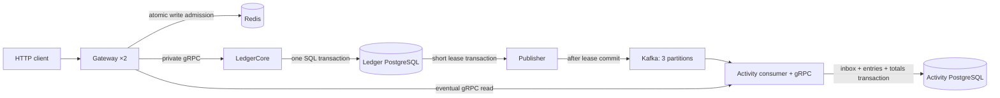

# LedgerCore events architecture

LedgerCore remains the authority for funds, journal and idempotency. Gateway, LedgerCore and Activity are three application services; publisher is an auxiliary LedgerCore process with a separate least-privilege role. This is a local educational system with test RUB funds and one trusted API client identity.

The PostgreSQL databases share one server in Compose but have separate ownership and service credentials. Activity cannot query Ledger tables, and Ledger cannot update Activity. Administrative reconciliation alone has read connections to both; it does not create a distributed transaction.

## Synchronous command boundary

Gateway authenticates HTTP and executes a Redis Lua admission check for authenticated `POST /v1/*`. The client key is a SHA-256 token identity, not the raw bearer. Both Gateway instances share the same write key, limit and window. Reads bypass this budget. A denied request returns 429; a Redis failure returns 503 before Ledger invocation. Admission does not reserve or validate money.

The versioned `ledger.v1.LedgerService` adapts the original `internal/store` application operations. The retained `cmd/api` HTTP adapter calls that same Store. Gateway and Activity contain no copy of the money algorithm.

1. Validate and normalize UUIDs, currency, integer amount, metadata and idempotency key; compute a canonical fingerprint.
2. Begin READ COMMITTED and reserve `(operation kind, key)`. A concurrent duplicate waits for the earlier transaction; a matching committed outcome is replayed, while a different fingerprint returns conflict.
3. Lock both account rows in ascending UUID order. Validate funds, checked int64 bounds, protected accounts and reversal rules under those locks.
4. Insert the immutable transaction header, two balanced postings, both balance/sequence projections, final idempotency outcome and one logical outbox event for a new ordinary transfer/reversal. A final business refusal stores its outcome without journal or event. Rollback leaves no partial effects.
5. Deferred database constraints check journal shape, reversal linkage, idempotency completion and required event presence. Return success only after commit. The original bounded whole-transaction SQL retry for serialization/deadlock remains in Store.

Funding uses a distinct opt-in fixture credential and is excluded from the event stream. Money is SQL BIGINT with checked int64 arithmetic; HTTP/event JSON amounts are strings, Protobuf operation amounts are int64 kopecks. Journal mutation grants/triggers, deferred balanced-entry constraints and independent NUMERIC reconciliation retain the original financial protection boundary. A database owner remains outside that boundary; see [invariants](invariants.md).

There is no Kafka or Redis call inside the financial transaction. Kafka acceptance is not required for command success. No cross-database transaction or distributed atomic commit is claimed.

## Transport, retries and ambiguous results

Private unary contracts are `ledger.v1` and `activity.v1`; generation/tool versions, money semantics and the domain → gRPC → HTTP table are in [proto/README.md](../proto/README.md). Removed proto names/numbers must be reserved; additions are compatible optional fields.

Application RPCs require separate `INTERNAL_RPC_TOKEN`. In Compose ports 50051/50052 stay private; plaintext is restricted to that local network. Health Check is unauthenticated on the private network. RPCs cap context at 4 s, messages at 1 MiB, headers at 16 KiB, streams at 64 per connection and admitted application calls at 64 per service. Context cancellation reaches SQL. Gateway HTTP bodies are capped at 32 KiB and metadata at 16 fields/2048 encoded bytes.

Gateway retries only UNAVAILABLE, once, within one overall 4 s context, preserving request, key and request ID. Unkeyed CreateAccount is never automatically retried. Built-in gRPC retries and DNS TXT service-config lookup are disabled; retry/deadline policy stays in this client and external TXT timeout cannot delay resolved Docker service names. Known domain errors map to bounded codes; SQL/internal error text is sanitized. Interceptors propagate UUID request IDs and record fixed method/code metrics without bodies, keys or tokens.

A deadline or broken response can occur after commit. The client resolves it by replaying the same key/parameters or fetching the known operation ID. A replacement key asks for a new operation. The financial result can be committed while Activity is unavailable or stale.

## Outbox and producer

[Migration 002](../migrations/002_outbox.sql) begins events for new transfers/reversals. Existing operations and their idempotent replays are not backfilled. [Migration 003](../migrations/003_event_audit_boundary.sql) records a full-XID audit boundary; existing v002 events remain included. It lets the independent audit detect later missing events without assuming wall-clock commit order. An old writer deployed after required-outbox constraints fails commit rather than silently producing untracked operations.

The [v1 envelope](../schemas/ledger-operation-v1.schema.json) includes stable `event_id = journal_transaction_id`, schema/type, account IDs, positive string amount, RUB, source timestamp and optional reversal link. Metadata and credentials are excluded. `occurred_at` is journal creation time before commit, not the commit timestamp. Unknown optional JSON fields are accepted; incompatible versions/types and invalid values are classified permanent failures.

Publisher claims at most 32 due events using `FOR UPDATE SKIP LOCKED` in a short transaction. A fresh UUID identifies each lease, default 30 s. Claim commits before any Kafka call; no DB connection/row locks are held during delivery. Success/retry updates match both event ID and lease owner, so an old owner cannot overwrite a reclaimed event. The publisher role can modify delivery columns but cannot write accounts/journal or mutate event data.

franz-go producer idempotence is enabled by default; `acks=all`, linger 5 ms, request timeout 8 s, record/send budget 10 s, 2 MiB batch cap and 4096 buffered records are configured. Polling is 100 ms when idle. Exponential publish retry delay is bounded by 30 s. Each result is matched to its record pointer, since callbacks across partitions can complete out of input order. `published_at` is written only after that record's Kafka acknowledgment.

If Kafka accepts a record and the publisher stops before SQL acknowledgment, the same event is published after lease recovery. Protocol idempotence does not eliminate this application crash window. Delivery is at-least-once with a deduplicated projection, not distributed exactly-once.

No automatic outbox cleanup or hard backlog quota is implemented. Unpublished events survive outages until PostgreSQL storage is exhausted; disk failure rejects the entire source transaction. Monitor backlog count, oldest age and free disk; published rows also accumulate. Cleanup and historical backfill are explicit future work.

## Kafka, inbox and projection boundary

`ledger.operations.v1` uses the journal UUID as key. One broker/controller runs KRaft with 3 partitions, replication factor 1 and minISR 1; DLQ has the same partition count. Retention is 168 hours or 268435456 bytes per partition, segments 64 MiB. Volumes persist ordinary restarts. `acks=all` acknowledges this one in-sync replica; it does not protect against losing that node/disk.

Ordering exists within one partition only. Operations on an account can enter different partitions; multiple publishers need not follow original commit order. Activity applies each event independently, including a reversal before its original. A reversal contributes a distinct incoming/outgoing operation rather than mutating old statistics. There is no original-event FK requiring prior arrival. Activity sequence orders projection application, not global financial commit time.

Activity disables auto-commit, starts a new group at the retained beginning, and uses BlockRebalanceOnPoll. Each partition executes sequentially, with bounded parallelism across partitions (3 in Compose), up to 500 records per poll and a 15 s record budget. Assignment is held until successful prefixes are committed, then rebalance is allowed.

For each event, one SQL transaction inserts unique inbox ID/fingerprint, both account entries and NUMERIC totals/counts. Summary locks use ascending UUID order. Identical replay is a no-op; changed content under the same ID is a permanent conflict. Only after SQL commit does Activity commit the source offset. A crash between them replays without changing totals again. Database failures receive at most three attempts with context-aware 25/50 ms pauses; a persistent fetch/SQL/offset/DLQ error stops the process rather than skipping the record. Operator restart resumes the uncommitted prefix.

Malformed/unsupported/conflicting input is sent to `ledger.operations.dlq.v1` before source offset commit. Stable DLQ source ID is `topic/partition/offset`; its envelope contains classification, bounded base64 payload, original length/hash and truncation flag. Failed DLQ delivery leaves the source uncommitted; duplicate DLQ records are possible. Valid input is capped at 1 MiB; broker/DLQ capacity is 2 MiB.

Inbox/entries are unique by event ID and `(event ID, account ID)`. Sums and counts use PostgreSQL NUMERIC and decimal strings to avoid int64 aggregate overflow. This is operation history/statistics, not an authoritative wallet balance. Empty projection is a valid empty page, not evidence of account nonexistence. History uses account-local application sequence, first-page upper bound and exclusive opaque cursor; limit 1..100. Late arrivals appear when starting a new page sequence.

A new group replays retained records into the same inbox without doubling effects. Inbox has no expiry. Broker retention bounds rebuild/replay: expired events without an archive cannot be recovered by resetting offsets.

## Health, metrics and operations

Gateway readiness checks Ledger gRPC health and Redis within 1 s; Activity is not its dependency. Ledger health checks its DB. Publisher checks its DB and Kafka; Activity checks its DB and Kafka, not zero lag. `/livez` means the listener/process responds, not that every dependency is available. Persistent consumer errors end Activity and require restart; Compose has no automatic restart policy.

Ledger/Activity default DB pools are 16 each (validated 1..128), publisher 4, each Gateway Redis pool 16 with at most 4 concurrent dials and a 300 ms admission context. Pools and service/partition admission bound concurrency. Shutdown cancels background work and drains with bounded contexts, leaving ambiguous delivery replayable. Compose allows 15 s for Go components before forced termination.

Metrics cover HTTP/gRPC timing/status, Redis allowed/limited/error decisions, outbox backlog/age/retries, duplicate/DLQ outcomes, observed partition lag, event-to-projection timing and pools/admitted concurrency. Activity visibility starts at pre-commit `occurred_at` and includes final source SQL work. Benchmark separately uses PostgreSQL commit timestamps (`track_commit_timestamp=on`) for commit-to-visible measurement. Lag is last fetched high-watermark minus processed offset, not a continuously refreshed broker-wide gauge.

Labels contain fixed routes/methods/statuses/outcomes and configured partition numbers. IDs are permitted in safe logs but never labels; payloads, tokens and raw SQL errors are omitted. No HA broker cluster, money cache or production banking claim is included.

The financial audit uses one REPEATABLE READ READ ONLY snapshot. Projection audit independently reconstructs entries and NUMERIC aggregates, then compares expected journal events/outbox/inbox ID sets and payloads. Cross-database completeness requires quiescent writers; no shared snapshot is claimed. See [failure scenarios](failure-scenarios.md), [runbook](runbook.md), [extension acceptance](events/acceptance.md) and [measurements](benchmarks.md). Original architecture is preserved in [architecture-ledger-v1.md](architecture-ledger-v1.md).
